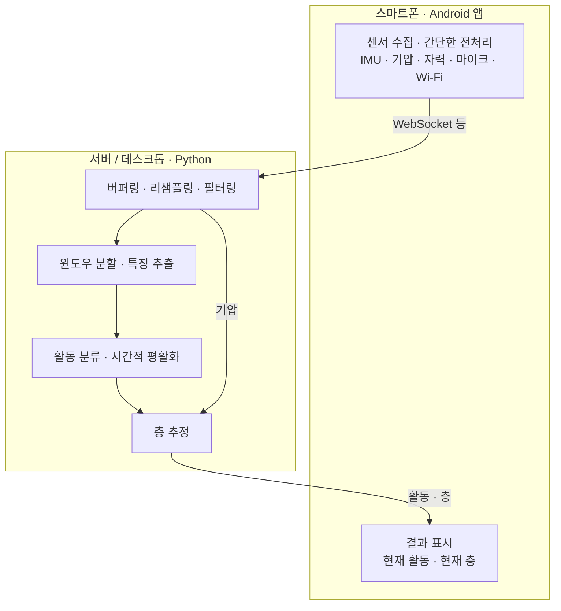

# Term Project 분석 — Human Walking Activity Recognition

- **원본**: `About term project.pdf` (슬라이드 6장)
- **과목**: Convergent IoT Project Design
- **출제**: Hyosu Kim (School of Computer Science and Engineering, Chung-Ang University · [HCS Lab](https://hcslab.cau.ac.kr))

> **1부**는 PDF에 실제로 적힌 내용이고, **2부부터**는 원문에 없는 해석과 구현 제안이다. 2부 이후는 과제 요구사항이 아니라 참고용이다.

## 한눈에 보기

| 항목 | 내용 |
|---|---|
| 목표 | 208관에서 스마트폰(또는 IoT 기기)으로 사용자의 보행 활동을 **지속적으로** 추적 |
| 요구사항 #1 | 보행 활동 4종 분류 — Walking / Climbing Up Stairs / Climbing Down Stairs / Using Elevators |
| 요구사항 #2 | 사용자의 **현재 층** 보고 |
| 허용 가정 | 휴대 방식 고정, 천천히 걷기, 1층에서 앱 버튼으로 시작 등 현실적인 시나리오 |
| 제약 | 환경에 **추가 인프라 설치 금지** (기존 Wi-Fi AP 같은 기설치 인프라는 사용 가능) |
| 구현 방향 | 스마트폰은 수집·결과 표시만, **연산은 서버/데스크톱**에서. 최고 샘플링 레이트 + 멀티모달 센싱 |

**핵심 분석**: "1층에서 시작" 가정 덕분에 **기압계로 1층 대비 상대 고도만 추적하면 층 추정(R2)이 가능**하다. 또 **걸음 유무(IMU) × 고도 변화의 방향·속도(기압계)** 조합만으로 4개 활동(R1)을 1차 구분할 수 있다. 지자기·Wi-Fi·음향은 정확도를 높이는 보조 수단으로 쓰는 구성이 현실적이다.

---

## 1부. 원문 정리

### 1.1 주제와 목표 (Slide 2)

- **주제**: Human Walking Activity Recognition
- **목표**: 208관 건물 안에서 스마트폰(또는 IoT 기기)으로 사용자의 보행 활동을 지속적으로 추적하는 시스템

### 1.2 요구사항 (Slide 2)

**Requirement #1 — 보행 활동을 4종으로 분류**

| # | 클래스 | 설명 |
|:-:|---|---|
| 1 | Walking | 평지 보행 |
| 2 | Climbing Up Stairs | 계단 오르기 |
| 3 | Climbing Down Stairs | 계단 내려가기 |
| 4 | Using Elevators | 엘리베이터 이용 |

**Requirement #2 — 현재 층(floor level) 보고**

### 1.3 허용되는 가정과 제약 (Slide 3)

현실적인 특정 시나리오를 가정해도 된다. 슬라이드의 예시:

- 스마트폰을 항상 **주머니에** 넣고 다니거나, 항상 **특정 그립으로 손에** 들고 다닌다
- **천천히 걷는다** (달리지 않는다)
- **1층에서** 인식을 시작한다 (예: 앱의 버튼을 눌러서)

단, **환경에 추가 인프라를 설치해서는 안 된다.** 이미 설치된 인프라(예: 기존 Wi-Fi AP)는 사용해도 된다.

### 1.4 사용 가능한 센싱 기법 (Slide 4)

| 기법 | 주로 쓰는 센서 |
|---|---|
| IMU 기반 보행(gait) 분석 | 가속도계, 자이로스코프 |
| 음향 기반 보행 분석 | 마이크 |
| 기압계 기반 실내 층 추정 | 기압계 |
| 지자기(자력계) 기반 위치 추정 | 자력계 |
| Wi-Fi RSSI 기반 위치 추정 | Wi-Fi (기존 AP 신호) |

슬라이드 목록이 "…"으로 끝나므로 위 기법은 예시이고, 다른 기법도 쓸 수 있다.

### 1.5 구현 팁 (Slide 5–6)

**스마트폰은 데이터 수집과 결과 표시에만 쓰고, 연산은 서버나 데스크톱에서 한다.** 슬라이드 5의 구조도:

슬라이드 6의 추가 팁:

| 팁 | 슬라이드의 예시 |
|---|---|
| 가능한 가장 높은 샘플링 레이트 사용 | Android IMU는 `SENSOR_DELAY_FASTEST`, 오디오는 48 kHz 이상 |
| 가능한 많은 센서 사용 (멀티모달 센싱) | 음향 핑거프린팅을 쓴다면 스테레오 마이크 사용 |
| 스마트폰 하드웨어의 영향 최소화 | Android 녹음 소스로 `MediaRecorder.AudioSource.UNPROCESSED` 사용 — 일부 기종은 스테레오·unprocessed 녹음 미지원 |

---

## 2부. 분석 및 제안

> 여기부터는 원문에 없는 내용이다. 수치는 대략적인 참고값이므로 208관에서 직접 측정해 정해야 한다.

### 2.1 요구사항 해석

- **"Continuously track" → 온라인 처리.** 녹화 후 일괄 분석보다는 걷는 동안 활동과 층이 계속 갱신되는 형태로 보는 것이 자연스럽다. 슬라이드 5도 분석 결과를 폰으로 돌려보내 보여주는 구조다.
- **R1과 R2는 연결돼 있다.** 층은 계단·엘리베이터로 이동할 때만 바뀌고 Walking 중에는 바뀌지 않는다. 따라서 활동 분류 결과를 층 갱신의 조건(게이트)으로 쓸 수 있다 (2.5 ③).
- **"1층에서 시작" 가정이 층 추정을 크게 단순화한다.** 절대 층을 맞힐 필요 없이 시작 시점의 기압을 1층 기준값으로 잡고 상대 변화만 추적하면 된다.
- **4개 클래스에 '정지' 상태가 없다.** 실제로는 엘리베이터 대기, 계단참·복도에서 멈춤 같은 정지 구간이 반드시 생긴다. 내부적으로 `Idle` 상태를 두고 출력 시 어떻게 표시할지 정해야 한다 (3장 질문 목록).
- **엘리베이터는 방향까지 알아야 한다.** R1의 출력은 'Using Elevators' 하나지만 R2를 위해 내부적으로는 상승·하강을 구분해야 한다.
- **"추가 인프라 금지"의 범위.** BLE 비콘이나 UWB 앵커를 건물에 설치하는 방식은 안 된다. 사용자가 지니는 기기(스마트폰, 웨어러블 등)는 인프라가 아니므로 허용 범위로 보인다.
- **휴대 방식 가정은 활용하되 방향 변화에 대비한다.** 주머니 또는 손 중 하나로 고정하면 모델이 단순해진다. 다만 같은 주머니 안에서도 폰의 위아래·앞뒤 방향은 바뀔 수 있으므로, 방향에 무관한 특징(가속도 크기, 중력 기준 수직 성분)을 쓰는 것이 안전하다.

### 2.2 활동별 구분 단서

| 활동 | IMU (가속도·자이로) | 기압계 | 그 밖의 단서 |
|---|---|---|---|
| Walking | 주기적인 걸음 신호 (약 1–2 Hz) | 거의 일정 | 이동에 따라 Wi-Fi RSSI·지자기가 서서히 변함 |
| Climbing Up Stairs | 걸음 신호 + 평지와 다른 수직 가속·기울기 패턴 | **꾸준히 하강** (고도 상승) | 계단실 특유의 발소리 반향 |
| Climbing Down Stairs | 걸음 신호 + 오르기와 다른 착지 패턴 | **꾸준히 상승** (고도 하강) | 계단실 특유의 발소리 반향 |
| Using Elevators | **걸음 신호 없음**, 출발·정지 때 수 초간 수직 가감속 | 계단보다 **빠르게** 변함 | 금속 칸이라 지자기 크기가 크게 흔들리고 Wi-Fi 신호가 약해지는 경향, 문 개폐음·도착음 |

계단 오르기와 내려가기는 IMU 패턴만으로는 차이가 미묘할 수 있다. **기압 변화의 방향**이 가장 확실한 구분 단서다.

### 2.3 센서별 역할

| 센서 / 기법 | R1 활동 분류 | R2 층 추정 | 주의할 점 |
|---|:-:|:-:|---|
| 가속도계·자이로 | ◎ | △ | 휴대 방식·폰 방향의 영향을 받음. 계단 걸음 수를 세면 층 이동의 보조 근거가 됨 |
| 기압계 | ◎ | ◎ | 날씨·공조에 따른 드리프트. 기압계가 없는 기종도 있음 |
| 자력계 | ○ | △ | 엘리베이터 진입 검출에 유용. 실내 철골 구조 때문에 위치별 변동이 큼 |
| Wi-Fi RSSI | △ | ○ | 층마다 잘 잡히는 AP가 달라 층 교차 검증에 쓸 수 있음. Android는 스캔 횟수 제한이 있음 (2.7) |
| 마이크 | ○ | △ | 발소리·계단실 반향·엘리베이터 소리. 데이터량이 크고, 주변 대화가 녹음될 수 있어 개인정보에 유의 |

◎ 핵심 · ○ 유용 · △ 보조

### 2.4 제안 시스템 구조

슬라이드 5의 구조를 구체화하면 다음과 같다.

- **전송 방식**: 결과를 다시 받아야 하므로 양방향인 WebSocket이 편하다 (MQTT, HTTP도 가능).
- **네트워크**: 학교 Wi-Fi는 기기끼리의 직접 통신을 막아둔 경우가 있다. 막히면 (1) 노트북과 폰을 같은 핫스팟에 연결하거나, (2) 외부 서버나 터널링(ngrok 등)을 쓰거나, (3) 데이터 수집 단계에서는 폰에 파일로 저장한 뒤 업로드한다. 학습용 데이터는 로컬 저장을 병행하면 네트워크 문제로 잃지 않는다.

### 2.5 알고리즘 설계안

#### ① 베이스라인: 규칙 기반 판별

걸음 유무와 기압 변화율만으로 판별기를 먼저 만들어 두면 이후 머신러닝 모델의 비교 기준이 된다.

| 걸음 검출 | 기압 변화율 dP/dt | 판정 |
|:-:|---|---|
| 있음 | ≈ 0 | Walking |
| 있음 | 음수 (기압↓ = 고도↑) | Climbing Up Stairs |
| 있음 | 양수 (기압↑ = 고도↓) | Climbing Down Stairs |
| 없음 | 절댓값이 큼 | Using Elevators (부호로 상승·하강 구분) |
| 없음 | ≈ 0 | Idle (정지) — 출력 방식은 따로 정함 |

임계값을 정할 때 참고할 대략적인 수치와 요령:

- 지표 부근에서 높이 1 m당 기압은 약 0.12 hPa(≈ 12 Pa) 낮아진다 → 층고가 3–4 m라면 층당 약 0.35–0.5 hPa
- 계단의 수직 이동 속도는 대략 0.2–0.4 m/s(≈ 2.5–5 Pa/s)이고 엘리베이터는 보통 그보다 몇 배 빠르다. 단, 한 층만 움직이는 짧은 운행은 최고 속도에 도달하지 못해 계단과 비슷해질 수 있으므로 **걸음 유무를 1차 기준**으로 쓴다
- 기압 신호는 잡음이 커서, 몇 초 길이의 윈도우에 저역통과 필터를 거친 뒤 선형회귀 기울기로 변화율을 구하는 것이 안정적이다
- 걸음 검출은 가속도 피크 검출로 직접 구현하거나 Android의 `Sensor.TYPE_STEP_DETECTOR`를 쓸 수 있다 (지연·누락 여부는 확인 필요)

#### ② 머신러닝 분류기

- **윈도우**: 2–4초, 50% 겹침 (참고: 대표적인 HAR 데이터셋인 UCI HAR는 2.56초·50% 겹침)
- **특징 후보**
  - 가속도 크기·수직 성분의 평균, 표준편차, 최댓값·최솟값, RMS, 왜도·첨도
  - FFT 우세 주파수(걸음 주파수)와 대역별 에너지
  - 자이로 기반 기울기(pitch·roll) 변화량
  - 기압 기울기, 윈도우 내 고도 변화량
  - 자기장 크기의 분산
  - (선택) 음향 MFCC
- **모델**: 데이터가 적은 초기에는 Random Forest, SVM, XGBoost 같은 특징 기반 모델이 유리하다. 데이터가 충분히 쌓이면 1D-CNN·LSTM도 시도할 수 있다.
- **평활화**: 윈도우 단위 예측은 깜빡이므로 다수결 투표, HMM, 상태 머신 등으로 안정화한다. 예를 들어 계단참에서 잠깐 평지를 걷는 구간은 계단 상태를 유지하도록 처리한다.

#### ③ 층 추정

1. **기준값 설정** — 시작 버튼을 누른 뒤(1층) 몇 초간 기압을 평균해 기준 기압 P₀로 저장한다.
2. **상대 고도 계산** — `Δh = 44330 × (1 − (P / P₀)^(1/5.255))`. Android의 `SensorManager.getAltitude(P₀, P)`가 같은 식이다.
3. **층 변환** — `1 + round(Δh / 층고)`처럼 층고를 일정하게 가정하기보다, 208관을 한 번 오르내리며 **층별 Δh를 측정한 보정표**를 만들어 가장 가까운 층을 고른다. 1층·지하층처럼 층고가 다른 층에도 대응할 수 있다.
4. **이벤트 게이트** — 층 값은 계단·엘리베이터 구간이 끝났을 때만 갱신하고 Walking·Idle 중에는 고정한다.
5. **드리프트 보정** — Walking·Idle 중에 생기는 기압 변화는 날씨·공조로 인한 드리프트로 보고 기준값을 천천히 재조정한다. 단, 짧은 시간에 반 층 이상 변하면 분류 결과와 상관없이 층 이동으로 처리한다 (엘리베이터 검출을 놓친 경우 대비).
6. **교차 검증 (선택)** — 층별 Wi-Fi AP 패턴(어떤 AP가 가장 세게 잡히는지)이나 계단 걸음 수(층당 계단 칸 수)로 기압 기반 결과를 검증한다.

### 2.6 데이터 수집과 평가

**208관 사전 조사**

- 층 수(지하 포함)와 층별 높이
- 계단 위치와 구조 (층당 계단참 수, 칸 수)
- 엘리베이터 위치와 대수
- 층마다 잡히는 Wi-Fi AP 목록

**수집**

- 앱에 클래스 버튼을 두고 동작의 시작·끝에 눌러 라벨을 남긴다 (또는 영상을 찍어 나중에 라벨링).
- 여러 세션·여러 시간대(기압 드리프트 반영), 팀원 여러 명(걸음 패턴 차이)으로 수집하고, 휴대 방식은 정한 가정대로 고정한다.
- 개별 동작뿐 아니라 연속 시나리오도 수집한다. 예: 1층 시작 → 복도 보행 → 계단으로 두 층 오르기 → 보행 → 엘리베이터로 1층 복귀.

**평가**

- 활동 분류: 클래스별 Precision·Recall·F1, 혼동 행렬
- 층 추정: 전체 시간 중 올바른 층을 보고한 비율, 층 이동 후 올바른 층이 표시되기까지의 지연
- **주의**: 겹치는 윈도우를 무작위로 train/test에 나누면 거의 같은 구간이 양쪽에 들어가 정확도가 부풀려진다 → **세션 단위로 분리**한다.

### 2.7 Android 구현 체크포인트

| 항목 | 내용 |
|---|---|
| 기압계 탑재 여부 | 기압계가 없는 기종이 있다 → `getDefaultSensor(Sensor.TYPE_PRESSURE)`가 `null`인지 먼저 확인 |
| IMU 샘플링 상한 | Android 12+(targetSdk 31 이상)에서는 `SENSOR_DELAY_FASTEST`를 써도 200 Hz로 제한된다 → 더 높이려면 `HIGH_SAMPLING_RATE_SENSORS` 권한 선언 |
| 좌표계 정규화 | `TYPE_ROTATION_VECTOR`·`TYPE_GRAVITY`로 지구 좌표계로 변환해 수직 가속도를 구한다 |
| 시간 동기화 | 센서 간 정렬은 `SensorEvent.timestamp`(ns) 기준, 서버에서 공통 시간축으로 리샘플링 |
| Wi-Fi 스캔 | Android 9+는 포그라운드 앱도 2분에 4회로 스캔이 제한된다 (Android 10+는 개발자 옵션에서 해제 가능). 스캔 결과를 받으려면 런타임 권한(버전에 따라 위치 또는 근처 Wi-Fi 기기 권한)이 필요하다 |
| 오디오 | 슬라이드의 `MediaRecorder.AudioSource.UNPROCESSED` 상수를 `AudioRecord`에 넘기면 압축되지 않은 PCM을 받을 수 있다. 지원 여부는 `AudioManager.PROPERTY_SUPPORT_AUDIO_SOURCE_UNPROCESSED`로 확인. 48 kHz·16 bit 스테레오는 약 192 KB/s |
| 화면 꺼짐 | 주머니 시나리오에서는 화면이 꺼지므로 Foreground Service로 수집한다 (Android 14+는 서비스 타입 선언 필요) |
| iOS | 일반 앱에는 Wi-Fi 스캔 API가 공개되지 않아 Wi-Fi RSSI 기법을 쓰기 어렵다. 슬라이드 팁도 Android 기준이므로 **Android 권장** |

### 2.8 예상 난관과 대응

| 난관 | 영향 | 대응 |
|---|---|---|
| 기압 드리프트 (날씨, 공조, 문 개폐) | 층 오판 | 상대 변화만 사용, Walking·Idle 중 기준값 재조정, 이벤트 게이트 |
| 계단참의 짧은 평지 구간 | 계단↔평지 판정이 깜빡임 | 평활화, 기압 추세는 더 긴 윈도우로 판단 |
| 엘리베이터 대기와 탑승 구분 | Idle과 Elevator 혼동 | 기압 변화 + 수직 가감속 + 지자기 변화를 함께 사용 |
| 한 층짜리 짧은 엘리베이터 운행 | 기압 변화율이 계단과 비슷해질 수 있음 | 걸음 유무를 1차 기준으로 사용 |
| 기종 차이 (센서 유무, 잡음, 샘플링) | 결과 재현성 저하 | 데모 기종 고정, 기종별 보정 |
| 반응 속도 vs 안정성 | 윈도우가 길수록 안정적이지만 늦게 반응 | 윈도우 길이·평활화 강도를 실험으로 결정 |
| 학교 네트워크 제약 | 폰↔노트북 통신 실패 | 핫스팟, 외부 서버·터널링, 로컬 저장 병행 |

---

## 3. 교수님께 확인할 사항

PDF에 없거나 해석이 갈릴 수 있는 부분:

- [ ] 정지(Idle) 상태를 따로 출력해도 되는지, 엘리베이터 대기 시간은 어떤 클래스로 보는지
- [ ] 실시간 결과 표시가 필수인지, 사후 분석도 인정되는지
- [ ] 대상 층 범위(지하 포함 여부)와 사용할 계단·엘리베이터가 정해져 있는지
- [ ] 평가 방식: 데모 시나리오, 정확도 측정 방법, 목표 성능
- [ ] 마감일, 팀 구성, 제출물(보고서·코드·데모 영상·발표) — PDF에 없음
- [ ] iOS 기기나 별도 IoT 기기(외부 센서 보드, 웨어러블)를 써도 되는지

## 4. 진행 체크리스트

- [ ] 208관 사전 조사 (층 수·층고, 계단·엘리베이터 위치, Wi-Fi AP)
- [ ] 팀원 스마트폰 센서 확인 (기압계, 스테레오·UNPROCESSED 녹음 지원)
- [ ] 시나리오 가정 확정 (예: 폰은 항상 바지 앞주머니)
- [ ] 수집 앱: 센서 로깅 + 라벨 버튼 + 서버 전송
- [ ] 서버: 수신·저장 파이프라인
- [ ] 라벨링된 데이터셋 수집 (클래스별, 여러 세션)
- [ ] 기압계 기반 층 추정 베이스라인
- [ ] 규칙 기반 활동 분류 베이스라인
- [ ] 머신러닝 분류기 + 멀티모달 특징 + 평활화
- [ ] 실시간 파이프라인 통합, 앱에 결과 표시
- [ ] 평가 (혼동 행렬, 층 정확도, 지연) 및 데모 리허설
